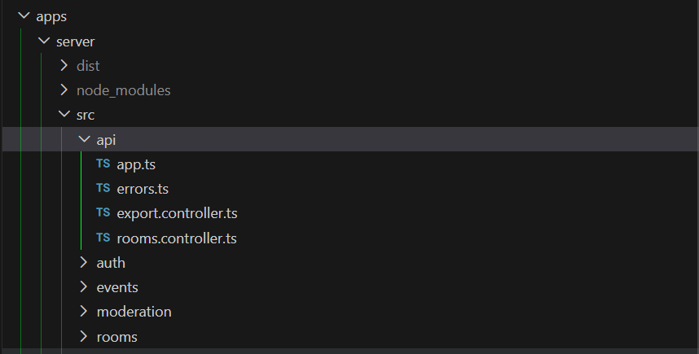
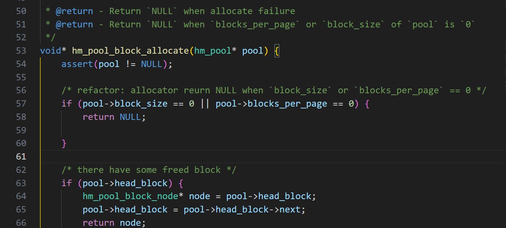

> 该文档用于记录我常用的 VS Code 的全局配置


## 让文件树更清晰和好看

```json
{
    "workbench.tree.indent": 18,
    "workbench.tree.renderIndentGuides": "always",
    "workbench.colorCustomizations": {
        "tree.indentGuidesStroke": "#01fa22"
    }
}
```

效果如下:   




## 高亮成对括号之间的竖线

```json
{
    "editor.guides.bracketPairs": "active",
    "editor.guides.bracketPairsHorizontal": false
}
```

效果如下:   




## 纵享丝滑

```json
{
    "editor.smoothScrolling": true,
    "workbench.list.smoothScrolling": true,
    "terminal.integrated.smoothScrolling": true
}
```

你也可以在设置中直接搜索 `smooth`, 然后把能开的都开了  


## 文件自动保存

```json
{
    "files.autoSave": "afterDelay",
    "files.autoSaveDelay": 10000
}
```

我选择的是10秒后自动保存一次, 我之前有一次 VS 崩了, 东西就没了, 虽然我的VSCode还没出现这种情况, 但是还是自动保存好点  